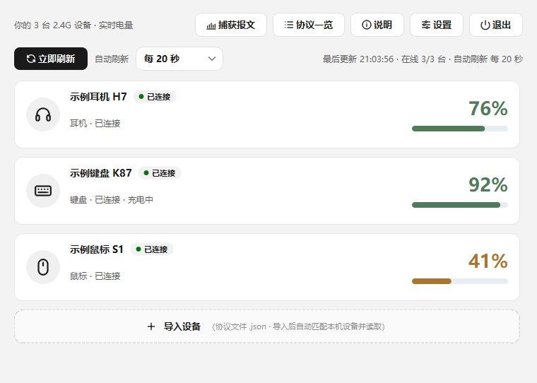
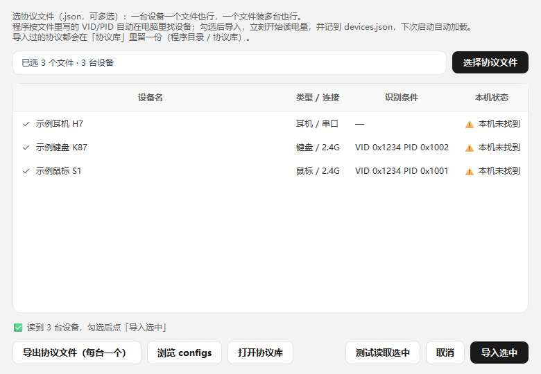
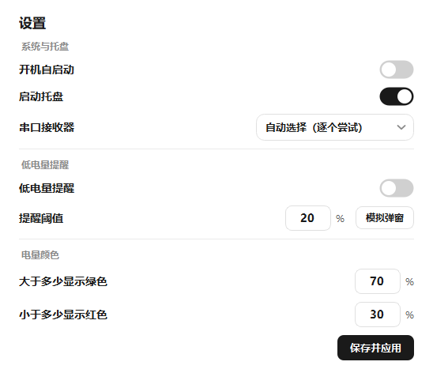

# open24g-batmon

**通用 2.4G 无线外设电量监控（Windows 桌面程序）—— 配置驱动，新增设备只需要加一份 JSON。**

[](LICENSE)
[](https://github.com/jiumo1436/open24g-batmon/releases/latest)


程序直接向本机的 2.4G 接收器发查询帧读电量：**不装厂商驱动、不开厂商软件、不读蓝牙、不联网**。
HID（USB 报文）与串口（虚拟 COM）两条通道共用同一套通用解析引擎。

> **程序里没有一行设备协议代码。**
> 帧头、字节偏移、字节序、换算方式、校验算法全部来自 `configs/` 下的配置文件。
> 想支持一台新设备，只需写一份 JSON，**不用改 Python 源码、不用等作者发版** ——
> 这正是本项目「社区共建设备协议库」的设计目的。

---

## 为什么值得用

| 亮点 | 说明 |
| --- | --- |
| **配置驱动，零硬编码** | 源码内不含任何 VID / PID / 帧头 / 换算公式；支持的设备 = `configs/` 里配置文件的数量 |
| **社区共建协议库** | 谁手上有设备谁写配置，一份 JSON 就能让所有人用上；PR 门槛写得很清楚（见 [贡献指南](docs/contribute-guide.md)） |
| **一条引擎跑两类接收器** | HID 与串口共用 `read` / `reply` 语法，换通道不用重写配置 |
| **换算能力够用** | 单字节 / 多字节端序 / 掩码抠位 / 线性系数 / 查表插值 / 安全公式 / 电压→百分比 / 关机假帧 |
| **异常不崩** | 配置写错给中文提示并跳过，设备掉线自动重试，后台线程读取，单台卡死不拖累其它 |
| **原生小工具** | 单文件 Qt 程序、无控制台、托盘三环图标、开机自启、低电量弹窗、电量配色可调 |

## 界面截图

| 主界面 | 导入配置 |
| --- | --- |
|  |  |

| 设置（颜色 / 托盘 / 自启 / 提醒 / 串口） | 托盘三环图标 |
| --- | --- |
|  |  |

> 截图中的设备名、电量均为演示用示例配置与界面示意，不代表任何真实产品。

## 功能一览

| 分类 | 能力 |
| --- | --- |
| 读取 | HID 报文 / 串口两条通道；被动监听、握手帧、多帧查询、定长补零、重试、双发送通道自动回退 |
| 显示 | 设备卡片（名称 / 类型 / 连接方式 / 电量 / 充电状态 / 上次读数时间）、协议一览 |
| 托盘 | 1~3 个电量环，只画电量最低的三台；悬停列出全部设备；左键唤起、右键退出 |
| 提醒 | 低电量阈值弹窗（可关）、电量配色阈值（可调）、颜色实时预览 |
| 系统 | 开机自启（可带 `--tray` 静默启动）、单实例、窗口位置与偏好记忆 |
| 配置 | 图形化导入 + 批量导入整个 `configs/`（递归子目录）、导入前「测试读取」、协议导入导出 |
| 诊断 | 「捕获报文」快速抓取 / 深度探测，直接看本机接收器的真实报文，便于写配置 |
| 容错 | 配置校验中文化、坏文件跳过、日志滚动、全局异常兜底 |

## 快速开始

**方式一：直接下载打包版（推荐，免装 Python）**

👉 **下载页：<https://github.com/jiumo1436/open24g-batmon/releases/latest>**

在 Releases 页面下载 `open24g-batmon-<版本>-win64.zip`，解压后双击 `设备电量监控.exe`。
`configs/` 必须与 exe 放在同一目录（压缩包内已带好）。

> **为什么仓库里看不到 `dist/` 和 exe？** 可执行文件属于「构建产物」，体积大（单文件 46 MB）、
> 二进制无法代码审查，所以不入版本库，统一通过 Releases 分发；仓库里只放源码和配置。
> 想自己从源码打包见文末「打包」一节。

**方式二：源码运行**

```bash
pip install -r requirements.txt   # PySide6（必需）+ PyYAML（仅在用 YAML 配置时需要）
python app.py
```

> 仅支持 Windows 10 / 11：读取走 Win32 HID / 串口 API，其他平台只能看界面，读不到数。

**第一次打开是空的，这是设计行为。** 程序不内置任何设备，界面显示「暂无设备」。要监控设备：

1. 点右上角「＋ 导入设备」；
2. 点「浏览 configs」一次列出整个 `configs/` 目录（递归子文件夹，自动跳过模板）；
3. 勾选后点「测试读取选中」，能读到电量再点「导入选中」；
4. 导入结果记进 `devices.json`，下次启动自动加载。

仓库自带三份**纯虚构的示例配置**（[`example-mouse.json`](configs/example-mouse.json)、
[`example-keyboard.json`](configs/example-keyboard.json)、
[`example-headphone.json`](configs/example-headphone.json)），仅用于演示语法，
换了真实设备不会匹配到任何东西 —— 请按 [配置制作教程](docs/config-making-guide.md) 抓包后自己写。

## 配置长什么样

一份配置 = 一个 JSON 文件，下面是最小可用形态（完整字段见 [字段说明](docs/config-schema.md)）：

```json
{
  "format": "dianliang-device-pack",
  "version": 1,
  "devices": [
    {
      "name": "我的无线鼠标",
      "type": "mouse",
      "match": { "vid": "0x1234", "pid": "0x1001", "usage_page": "0xFF00", "min_in": 17 },
      "read": {
        "query": ["A5 5A 01 00 00 00 00 00 00 00 00 00 00 00 00 00 00"],
        "checksum": { "mode": "sum_neg", "from": 1, "to": 16, "at": 16, "seed": "0x00" },
        "pad_to": 17,
        "reply": {
          "contains": ["A5 5A"],
          "battery": { "byte": 5 },
          "charging": { "byte": 6, "mask": "0x01" },
          "range": [1, 100]
        }
      }
    }
  ]
}
```

读流程：`passive_ms` 纯听 → `pre` 握手 → `query` 查询 → 在回包里找 `contains` 锚点 →
按 `battery` 规则换算 → 落到 `range` 内才算读到。

## 目录结构

```
open24g-batmon/
├── README.md                  # 本文件
├── LICENSE                    # MIT
├── .gitignore                 # 忽略私有偏好 / 打包产物 / 抓包文件
├── .gitattributes             # 统一换行符（LF）与二进制判定
├── app.py                     # 主程序（单文件：界面 + 通用解析引擎 + 导入机制）
├── open24g-batmon.spec        # PyInstaller 打包配置
├── requirements.txt           # 依赖
├── icon.ico                   # 软件图标
├── configs/                   # 设备协议配置库（社区共建的主战场）
│   ├── README.md              # 目录说明与命名规范
│   ├── template.json          # HID 协议模板（template: true，导入时被拒绝）
│   ├── serial-template.json   # 串口协议模板
│   ├── example-mouse.json     # 语法示例（虚构值）
│   ├── example-keyboard.json  # 语法示例（虚构值）
│   └── example-headphone.json # 语法示例（虚构值）
├── docs/
│   ├── config-schema.md       # 全部字段说明（写配置时对照查）
│   ├── config-making-guide.md # 抓包 → 分析 → 写配置 → 验证 的完整教程
│   ├── contribute-guide.md    # 社区贡献指南（PR 硬性准入条件）
│   ├── verify.md              # 手动验证清单（无硬编码 / 不崩溃 / 托盘 / 串口）
│   ├── publish-guide.md       # 仓库简介、topics、git 命令、Release 流程
│   ├── release-notes-template.md # Release 说明模板
│   └── repo-checklist.md      # 仓库自检核对清单
├── assets/                    # 截图与演示素材
│   └── README.md
├── tools/
│   ├── validate-config.py     # 命令行校验配置（不开界面）
│   └── check-filenames.py     # 检查文件名是否全为小写英文
└── .github/
    ├── pull_request_template.md
    ├── ISSUE_TEMPLATE/new-device-config.yml
    └── workflows/validate-configs.yml
```

运行时会在程序目录生成这些**私有文件，均已写入 `.gitignore`，绝不进仓库**：

| 文件 | 内容 |
| --- | --- |
| `user_settings.json` | 你的偏好：电量配色、托盘开关、开机自启、低电量提醒、串口端口 |
| `devices.json` | 你导入的设备列表（下次启动自动加载） |
| `cache.json` | 上次读数缓存（用于启动瞬间先显示灰值） |
| `协议库/` | 导入 / 导出协议时自动留存的副本 |
| `error.log` / `error.log.1` | 程序日志（超过 1MB 自动滚存） |

## 异常处理约定

| 场景 | 行为 |
| --- | --- |
| 配置损坏 / 缺字段 / 语法错误 / 版本不支持 | 中文提示（带字段名与行列），跳过该文件，程序继续运行 |
| 接收器拔出、设备休眠、串口断线 | 卡片转「未连接 / 未响应」，下一轮自动重试，不闪退 |
| 回包丢包、乱码 | 锚点重同步 + 校验失败即丢弃，接收缓冲有上限 |
| 批量导入几十份配置 | 递归读取、逐份独立校验，单份出错不影响其它 |
| 单台设备读取慢 | 后台线程逐台读，线程数封顶 8，一台卡住不拖累其它 |
| 未捕获异常 | 兜底钩子写日志 + 错误框，进程不退出 |
| `devices.json` 被改坏 | 跳过坏条目，其余设备照常加载；不覆盖你的原文件 |

逐条复现步骤见 [`docs/verify.md`](docs/verify.md)。

## 打包发布

```bash
pip install pyinstaller
python -m PyInstaller --clean --noconfirm open24g-batmon.spec
```

产物为 `dist/设备电量监控.exe`（单文件、无控制台、图标内嵌）。`configs/` **不打包进 exe**，
运行时从 exe 同目录读取，方便用户自行增删配置。发布步骤与说明模板见
[`docs/publish-guide.md`](docs/publish-guide.md)、[`docs/release-notes-template.md`](docs/release-notes-template.md)。

## 社区共建

1. 照 [`configs/template.json`](configs/template.json) 或 [`configs/serial-template.json`](configs/serial-template.json) 复制一份；
2. 按 [配置制作教程](docs/config-making-guide.md) 抓包、定位字段、填写；
3. 本地自检：

   ```bash
   python tools/validate-config.py            # 校验 configs/ 全部配置
   python tools/validate-config.py 我的配置.json  # 校验单个文件
   python tools/check-filenames.py            # 文件名规范
   ```

4. 在软件里「测试读取」通过后，按 [贡献指南](docs/contribute-guide.md) 提 PR。

**不要为了某台设备去改 Python 源码。** 通用引擎表达不了的协议，请开 issue 讨论「如何把它变成
新的通用能力」（例如新增一种校验算法），这样所有设备一起受益。

## 项目说明（请务必先读）

- 本项目**由 AI 辅助开发**（DeepSeek-V4.1-Flash-1017），代码、文档与配置模板均含 AI 生成内容。
- **维护者并非软件开发专业人士**，没有受过系统的软件工程训练，测试条件也仅限于手头有限的硬件。
  因此**软件可能存在未知缺陷**：读数错误、界面异常、占用资源、与其他软件冲突等，均无法排除。
- 本项目**仅供个人硬件学习与研究使用**。请勿用于生产环境、关键设备监控或任何需要可靠性保证的场合。
  因使用本软件造成的任何直接或间接损失，作者与贡献者不承担责任。
- 仓库内的设备配置文件由社区贡献。维护者**无法持有全部硬件**，只校验配置的 JSON 语法、
  字段完整性与参数逻辑合理性，**不做实物硬件验证**；配置的读数准确性由贡献者自行保证。

## 免责声明

- 本项目仅用于**硬件通信逆向学习与研究**：了解 2.4G 接收器如何收发报文、电量字段如何编码。
- **不用于破解、不用于绕过任何授权机制、不用于商业用途**，也不提供任何厂商固件、密钥或受版权保护的资源。
- 仓库内 `configs/` 的设备配置文件**由社区贡献**，版权归各贡献者所有，按 MIT 协议随项目分发；
  如权利人认为某份配置侵犯其权益，请开 issue 联系删除。
- 使用本软件即表示你理解并接受：读取行为发生在**你自己拥有的硬件**上，风险自负；
  因不当使用（包括但不限于违反设备厂商用户协议、干扰他人设备）产生的一切后果由使用者承担。
- 本项目与任何硬件厂商**无隶属、赞助或背书关系**，文中出现的商标、产品名仅用于说明兼容性。

## 许可

[MIT](LICENSE)。界面图标为 Tabler Icons（MIT）风格的 outline 路径；第三方依赖遵循各自许可证。
